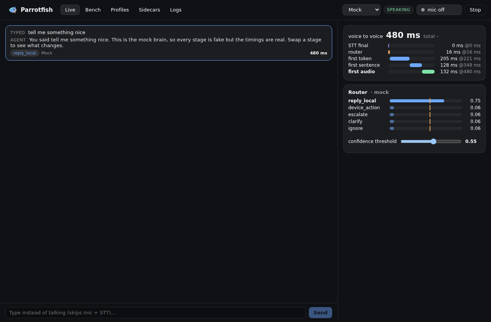

# Parrotfish

on-device realtime voice agent playground for Apple silicon Macs. every stage of the pipeline is its own swappable provider, every turn is timed, and you can A/B two stacks on the same recordings to see where the latency actually goes.



```
mic ─▶ VAD ─▶ STT ─▶ router (System One) ─┬─▶ brain ───────────┐
                                           ├─▶ tool caller ─────┤─▶ sentence splitter ─▶ TTS queue ─▶ speakers
                                           ├─▶ escalation agent ┘
                                           └─▶ clarify / ignore
            barge-in (you talk over it) cancels everything in flight
```

| stage | providers |
| --- | --- |
| mic + VAD | Silero VAD v6 (onnxruntime-node, model downloaded + sha256 pinned), energy (RMS) fallback |
| STT | Parakeet TDT v2 via `parakeet-api` (mlx, :8816), whisper.cpp `whisper-server`, any `/v1/audio/transcriptions`, sherpa-onnx in-process (optional) |
| router | llama-server `/v1/systemone` decision models (Kev-0.8B etc): `reply_local` / `device_action` / `escalate` / `clarify` / `ignore` with probabilities + confidence threshold, optional end-of-turn and barge-in questions. plus LLM-as-router baseline over any chat endpoint (json_schema constrained), and "none" |
| tool caller | OpenAI tool calling (LFM2-1.2B-Tool / FunctionGemma via `llama-server --jinja`). demo tools: `get_time`, `open_app`, `run_shell` (read-only allowlist, no shell), `create_note`. `open_app` and `create_note` wait for a click |
| brain | any OpenAI-compatible streaming chat endpoint |
| escalation | Claude Code (`claude -p --output-format stream-json --verbose`), Codex (`codex exec --json`). tool events become short spoken progress lines |
| TTS | **Phonon 31m in-process** (phonon-tts 0.4.0 WASM in a hidden cross-origin-isolated window, default), ptts-openai-server, ptts-ws-server, any `/v1/audio/speech`, macOS `say` |

everything else:

- **profiles**: named JSON in the app's data folder. built-ins: `default` (the Mac stack below), `Mock` (no servers at all), `baseline` (whisper.cpp + LLM router + `say`). form editor + raw JSON editor, quick switcher in the title bar
- **sidecar manager**: per-profile start commands (run through your login shell), health checks, logs pane
- **waterfall** per turn: VAD hangover, STT final, router, tools, first token, first sentence, first audio (when the first sample actually plays), done. voice-to-voice = end of speech to first audio
- **bench**: run saved WAVs (and/or typed lines) through one or two profiles, median/p90 table with the B−A delta, JSON export. a `.txt` next to a WAV is its transcript (the Mock STT returns it)
- **text mode**: type instead of talking, skips mic + STT
- click the logo 5 times

Phonon 40m is CC BY-NC, so it's never used or offered. Phonon 31m and the voices are Apache-2.0.

## getting started on the Mac (fish)

needs bun, Homebrew, and an M-series Mac. arm64 only.

```fish
git clone https://github.com/PylotLight/Parrotfish.git
cd Parrotfish
bun install
bun run dev
```

pick the **Mock** profile in the title bar and type something: the whole pipeline runs with fake stages so you can check the UI with no models. then set up the real stack. each server below matches a sidecar in the `default` profile, so you can also start them from the **Sidecars** tab instead of a terminal.

```fish
# STT: Parakeet TDT 0.6B v2 on mlx (:8816, /v1/audio/transcriptions)
brew install ffmpeg uv
uv tool install "parakeet-api[mlx]"
parakeet-api download mlx --id mlx-community/parakeet-tdt-0.6b-v2
env STT__MLX__MODEL_ID=mlx-community/parakeet-tdt-0.6b-v2 parakeet-api serve

# llama.cpp (needs a build with /v1/systemone, b11361 or newer)
brew install llama.cpp

# router: Kev-0.8B decision model (:8082, /v1/systemone)
llama-server -hf ggml-org/Kev-0.8B-GGUF:Q8_0 --port 8082

# brain: Qwen3 4B instruct (:8081)
llama-server -hf unsloth/Qwen3-4B-Instruct-2507-GGUF:Q4_K_M --jinja -c 8192 --port 8081

# tool caller: LFM2-1.2B-Tool (:8083). smaller alt: ggml-org/functiongemma-270m-it-GGUF
llama-server -hf LiquidAI/LFM2-1.2B-Tool-GGUF:Q4_K_M --jinja --port 8083

# escalation: Claude Code and/or Codex, signed in as usual
claude --version; codex --version
```

TTS needs nothing: the default profile runs Phonon 31m in-process and downloads it (~71 MB, pinned + checksum-checked) on the first sentence, or ahead of time from **Profiles → default → Phonon 31m model → Download + warm up**. the other Phonon options if you want to compare:

```fish
# ptts-openai-server (docker, :8880). pcm is s16le 24 kHz, speed is 1.0 only
docker run --rm -p 127.0.0.1:8880:8880 -e PTTS_LANG=en -e PTTS_QUANT=q8 ghcr.io/gradium-ai/ptts-openai-server:latest

# ptts-ws-server (:8080, /speech/tts), from a clone of gradium-ai/xn-ptts (needs `brew install opus`)
cargo run --release -p ptts-ws-server -- --quant q8 --lang en

# the CLI, handy for sanity checks
brew install gradium-ai/tap/ptts
ptts --lang en "Hello from Phonon." -o speech.wav
```

baseline profile extras:

```fish
brew install whisper-cpp
# grab a ggml model (e.g. ggml-large-v3-turbo.bin) into ~/models first
whisper-server -m ~/models/ggml-large-v3-turbo.bin --port 8090
```

then switch to `default`, hit **mic off → listening**, and talk. macOS asks for mic access the first time.

### what's verified vs not

checked against each project's README (Oct 2026), not run on a Mac by me:

- parakeet-api commands and port, llama-server `-hf` lines, the `/v1/systemone` request/answer shape (from ggml-org's decision models post), ptts-openai-server docker line, ptts-ws-server protocol, `claude -p --output-format stream-json --verbose`
- **unverified**: Kev-0.8B GGUF repo name/quant (`ggml-org/Kev-0.8B-GGUF:Q8_0`, the post lists Kev-4B), `codex exec --json` event names (parsed defensively), the sherpa-onnx provider (not a dependency, untested), LFM2 tool-call parsing through llama-server `--jinja`, and the brew formula names `llama.cpp` / `whisper-cpp` having `/v1/systemone` yet
- **run in CI / the Linux sandbox**: the whole orchestrator with mock providers (tests), every HTTP provider against fake servers, Silero VAD v6 through onnxruntime-node (real model), and the app booting under xvfb with two typed turns, including first audio coming back from the real renderer player and a real **Phonon 31m in-process** turn (loaded in ~1 s, cross-origin isolated, 2 threads)
- never tested: a real mic, real speakers, echo cancellation during barge-in, any real model server

## notes

- **barge-in**: speech start (≥150 ms) while the agent is thinking or talking cancels the turn and silences playback. with `router.askBargeIn` on, it instead waits for the utterance and asks the router whether it's a real interruption (so "mhm" doesn't stop it). mic capture has echo cancellation on, but use headphones if your speakers leak into the mic
- **end of turn**: with `router.askEndOfTurn`, a trailing fragment ("and...") under 0.5 is held and joined to your next utterance
- **threshold**: below the confidence threshold the router's pick becomes `router.fallback` (default `reply_local`). the slider on the Live view edits the active profile
- **first audio** on the Live view is when the first sample plays (scheduled start + output latency). in Bench nothing plays, so it's when the first chunk is synthesized
- escalation runs the CLI in `escalation.options.cwd` (default `~`) with your own CLI permissions. add flags like `["--permission-mode", "acceptEdits"]` (claude) or `["--full-auto"]` (codex) to `escalation.options.extraArgs` if you want it to edit things
- profiles, notes and downloaded models live in `~/Library/Application Support/parrotfish/`

## dev

```fish
bun run dev          # electron-vite dev
bun test             # mock-provider tests
bun run typecheck    # bun check
bun run lint         # oxlint
bun run build && bun run check:css
bun run dist:mac     # arm64 zip + dmg (unsigned)

# boot smoke: Mock profile, two typed turns, prints a JSON line and quits
bun run build; env PARROTFISH_SMOKE=1 ./node_modules/.bin/electron .
```

adding a provider: one file under `src/core/providers/<stage>/`, one line in `src/core/registry.ts`. the settings form picks up its options from the registry entry.

## license

MIT. Phonon runtime (MIT OR Apache-2.0), Phonon 31m weights and voices (Apache-2.0) and Silero VAD (MIT) are downloaded at runtime, not bundled.
